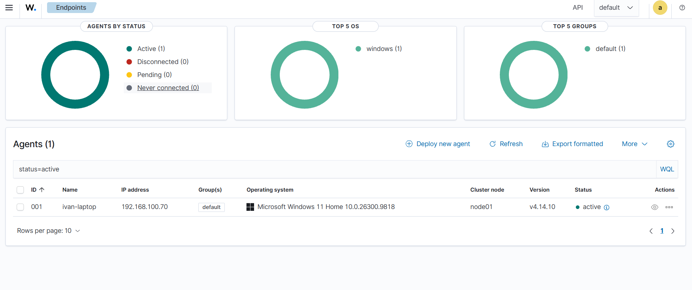
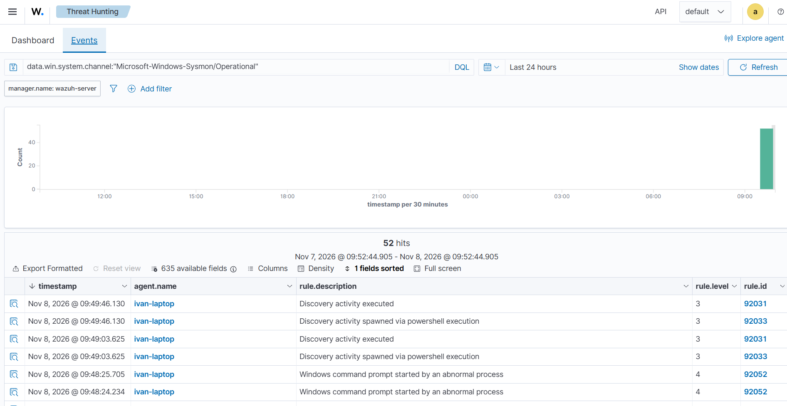
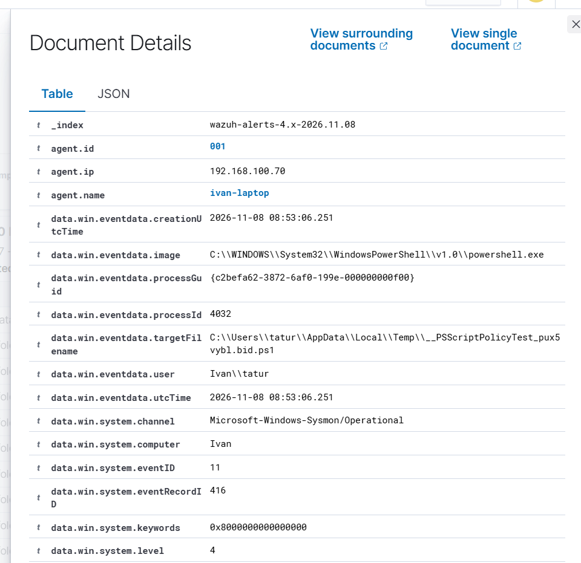
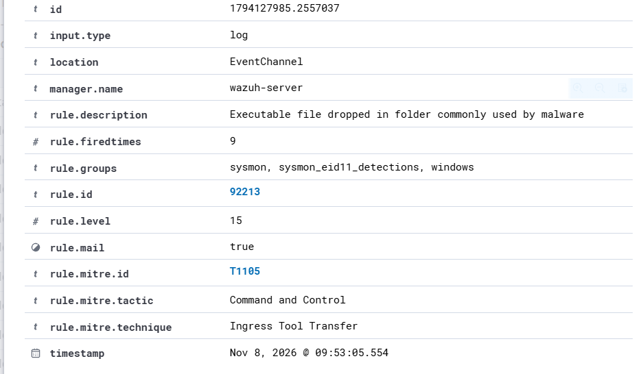
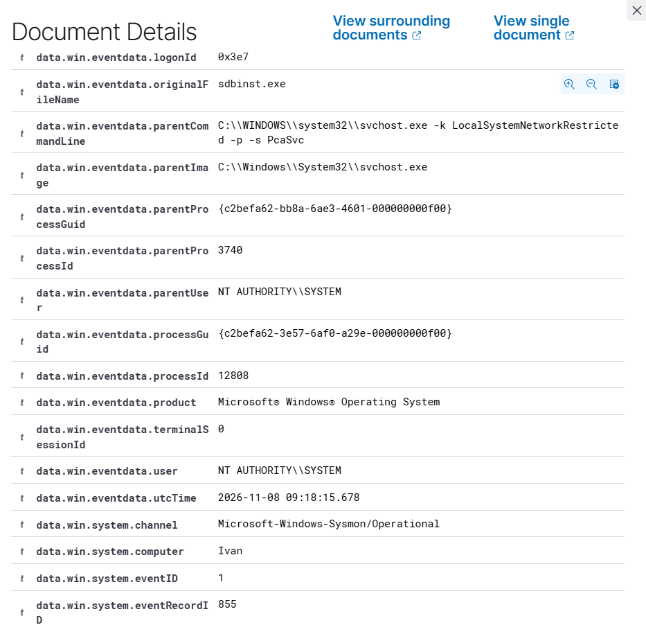
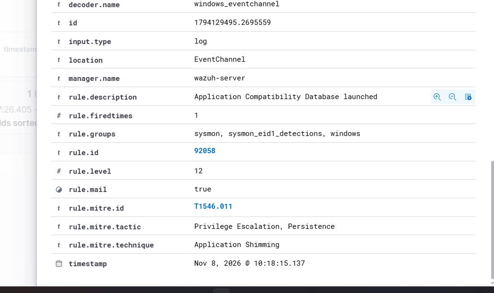
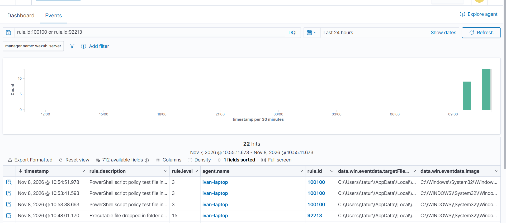
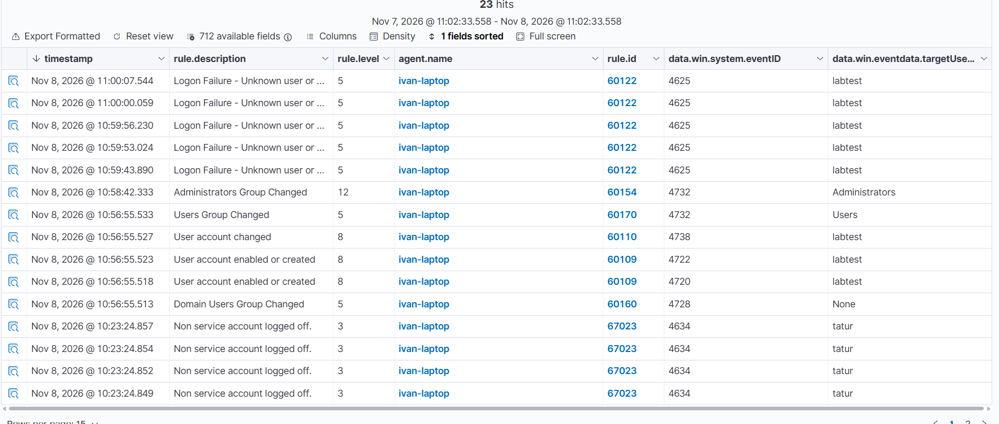
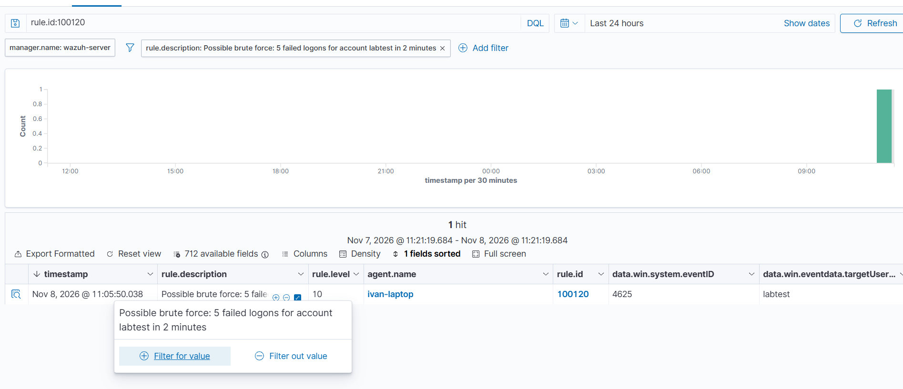
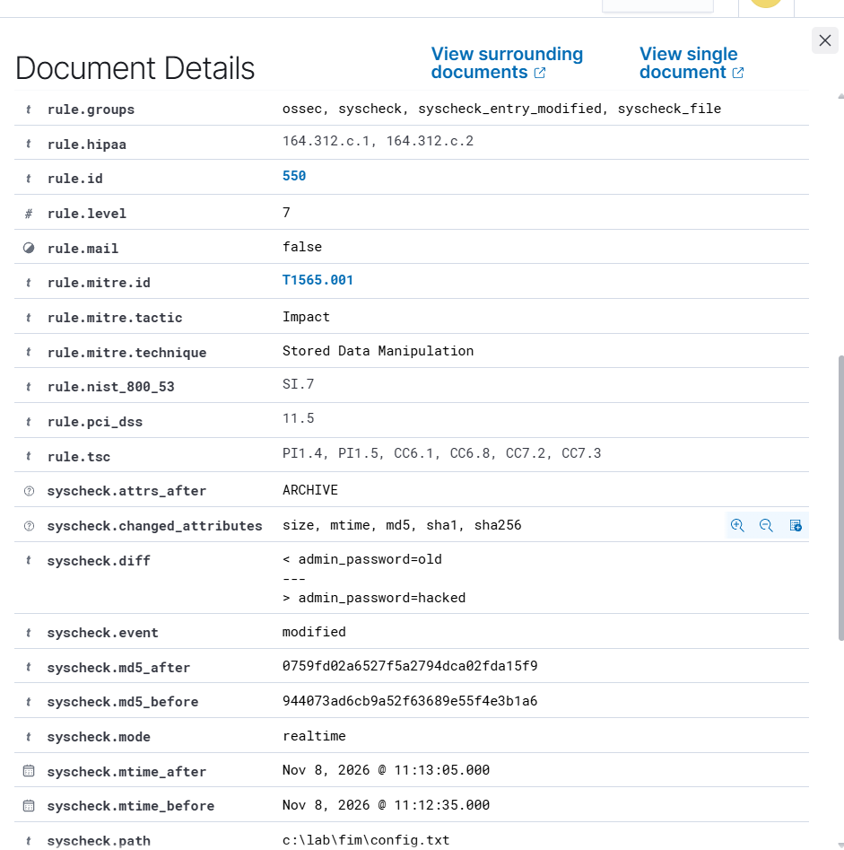

# soc-homelab

A home SIEM lab for **SOC Level 1 practice**. I deployed **Wazuh 4.14.10** in VirtualBox and used it to monitor
my own Windows 11 laptop with the Wazuh agent and **Sysmon**. The goal was not only to install a SIEM, but to use it
the way an L1 analyst does: **triage real alerts, tune noise, simulate an attack, write detection rules** and
monitor file integrity. Built over one weekend, 7–8 November 2026.

| Step | Result |
|---|---|
| Deployment | Wazuh OVA + Windows agent + Sysmon, events flowing end to end |
| Triage | 7 alerts of level 12+ → 6 **false positives**, 1 **benign true positive** |
| Tuning | custom rule `100100` turns a level-15 false positive into level 3 |
| Attack simulation | new local admin + password guessing + account deletion, all detected |
| Detection engineering | correlation rule `100120` for brute force (T1110) |
| File Integrity Monitoring | real-time FIM with content diff |

## Lab setup

```
Windows 11 laptop                                   Wazuh VM (VirtualBox)
Sysmon + Security log + FIM  --- Wazuh agent --->   manager -> rules -> alerts -> dashboard
                                   1514/tcp
```

| Component | Details |
|---|---|
| SIEM | Wazuh 4.14.10 all-in-one OVA (manager, indexer, dashboard), VirtualBox 7.2, 4 vCPU / 8 GB RAM, bridged network. SHA-512 of the OVA checked against the official checksum before import |
| Endpoint | Windows 11 Home, Wazuh agent 4.14.10 |
| Telemetry | Sysmon with the [SwiftOnSecurity config](https://github.com/SwiftOnSecurity/sysmon-config), Windows Security log, FIM |
| Configuration | Sysmon channel and FIM are pushed **centrally** through the agent group: [`config/agent.conf`](config/agent.conf) |
| Custom rules | [`rules/local_rules.xml`](rules/local_rules.xml) |



## 1. First detections: discovery commands

I ran the commands an attacker uses right after getting access, to see what Wazuh catches:
`whoami /all`, `net user`, `net localgroup administrators`, `systeminfo`.

| Rule | Description | Level |
|---|---|---|
| 92031 | Discovery activity executed | 3 |
| 92033 | Discovery activity spawned via PowerShell execution | 3 |
| 92052 | Windows command prompt started by an abnormal process | 4 |

Low levels are correct here: on their own these commands are normal admin work. They matter in a chain.



## 2. Triage: 7 alerts of level 12+

Within the first hour the dashboard showed 7 high-severity alerts, including **level 15** (the maximum).
I checked each one with the same chain: **parent process → user → file path → hash → signature → context**.

| Alerts | Rule | MITRE tag | Verdict |
|---|---|---|---|
| 6 | 92213 *Executable file dropped in folder commonly used by malware*, level 15 | T1105 Ingress Tool Transfer | **False positive** |
| 1 | 92058 *Application Compatibility Database launched*, level 12 | T1546.011 Application Shimming | **Benign true positive** |

### Case A – 92213, level 15: false positive

| Field | Value |
|---|---|
| Sysmon event | 11 (file created) |
| `image` | `C:\WINDOWS\System32\WindowsPowerShell\v1.0\powershell.exe` |
| `targetFilename` | `C:\Users\<user>\AppData\Local\Temp\__PSScriptPolicyTest_<random>.<random>.ps1` |

PowerShell writes this test script to `%TEMP%` **every time it starts** and deletes it straight away – it checks
whether script execution is allowed by App Control / AppLocker policy (`App Control for Business policy: Enforced`
on this machine). The rule sees "a `.ps1` file dropped in Temp", which is formally true, but this is normal
PowerShell behaviour. It fired once per PowerShell window I opened.




### Case B – 92058, level 12: benign true positive

| Check | Result |
|---|---|
| Command line | `C:\WINDOWS\System32\sdbinst.exe -m -bg` |
| Parent | `svchost.exe -k LocalSystemNetworkRestricted -p -s PcaSvc` – **Program Compatibility Assistant** service |
| User | `NT AUTHORITY\SYSTEM`, session 0 – a background service, not a person |
| Path | `C:\Windows\System32\` – the real location, not a copy in Temp |
| Version | `10.0.26100.9818` – matches the OS build |
| Hash | SHA256 in the alert **matches** the file on disk (`Get-FileHash`) |
| Signature | Microsoft Windows, **Valid** (`Get-AuthenticodeSignature`) |
| Context | the laptop had gone into Modern Standby a minute earlier |

The rule worked correctly – `sdbinst.exe` did run, and attackers use it for persistence. But here Windows itself
updated its compatibility database.




**Lesson:** the rule name and the MITRE tag are not evidence. "Ingress Tool Transfer" and "Application Shimming"
sound alarming; the raw event fields gave the answer.

## 3. Tuning the noise: rule 100100

Six level-15 alerts in one morning, just from opening PowerShell, would train an analyst to ignore level 15. I wrote a child rule
of 92213 that lowers only this exact case to level 3:

```xml
<rule id="100100" level="3">
  <if_sid>92213</if_sid>
  <field name="win.eventdata.image" type="pcre2">(?i)\\\\powershell\.exe$</field>
  <field name="win.eventdata.targetFilename" type="pcre2">(?i)\\\\AppData\\\\Local\\\\Temp\\\\__PSScriptPolicyTest_[a-z0-9]+\.[a-z0-9]+\.ps1$</field>
  <description>PowerShell script policy test file in Temp - known benign (tuned from 92213)</description>
</rule>
```

- **Narrow on purpose.** Both conditions must match: the process is `powershell.exe` **and** the file name follows
  the exact test-file pattern. Any other executable dropped in Temp still raises level 15. A broad exception
  ("ignore `.ps1` in Temp") would give an attacker a place to hide.
- **Level 3, not 0.** At level 0 Wazuh does not store the alert at all. At level 3 the event stays searchable for
  an investigation but no longer looks critical.
- **Verify on the server.** My first attempt through the dashboard editor did not reach the file. I found it by
  checking `local_rules.xml` over SSH, added the rule there, validated it with `wazuh-analysisd -t` and restarted
  the manager.

Result: from the restart on, the same file creates **100100 / level 3** instead of **92213 / level 15**.



## 4. Attack simulation: new local admin and password guessing

A classic persistence pattern (T1136.001 create account, T1098 account manipulation), done with a test account
that I deleted at the end:

```powershell
net user labtest * /add                        # password asked separately
net localgroup administrators labtest /add
runas /user:labtest cmd                        # 5x with a wrong password
net user labtest /delete
```

`*` makes Windows ask for the password instead of taking it from the command line. Sysmon logs full command lines,
so a password typed into the command would end up in the SIEM in plain text.

| Event ID | Rule | Level | What happened |
|---|---|---|---|
| 4720 / 4722 | 60109 | 8 | account `labtest` created and enabled |
| 4738 | 60110 | 8 | account changed |
| 4732 | 60170 | 5 | added to `Users` |
| **4732** | **60154** | **12** | **added to `Administrators`** |
| 4625 ×5 | 60122 | 5 | failed logons for `labtest` |
| 4726 | 60111 | 8 | account deleted |



A new local admin is already caught by the built-in rule 60154 at level 12. The gap was the password guessing:
5 failures in 24 seconds became 5 separate level-5 alerts, none of them saying "brute force".

## 5. Detection engineering: brute-force correlation rule 100120

```xml
<rule id="100120" level="10" frequency="5" timeframe="120">
  <if_matched_sid>60122</if_matched_sid>
  <same_field>win.eventdata.targetUserName</same_field>
  <description>Possible brute force: 5 failed logons for account $(win.eventdata.targetUserName) in 2 minutes</description>
  <mitre><id>T1110</id></mitre>
</rule>
```

Five failed logons (60122) **for the same account** within 120 seconds raise one level-10 alert with the account
name in the description. `same_field` matters: without it, five different users each mistyping a password once
would look like an attack. After repeating the failed logons, the rule fired on `labtest`.



## 6. File Integrity Monitoring

Real-time FIM on a test folder, with `report_changes` to see **what** changed, not only **that** it changed:

```xml
<directories realtime="yes" check_all="yes" report_changes="yes">C:\Lab\fim</directories>
```

| Action | Rule | Level |
|---|---|---|
| file created | 554 | 5 |
| file modified | 550 | 7 |
| file deleted | 553 | 7 |

The modification alert shows the diff (`admin_password=old` → `admin_password=hacked`), the hashes before and
after, and maps itself to **PCI DSS 11.5** and **NIST 800-53 SI-7** – in regulated companies FIM is an audit
requirement, not an option.



**The other side of `report_changes`:** the "password" from the test file is now stored in the SIEM in plain text.
For files that hold real secrets Wazuh has the `nodiff` option – the change is reported, the content is not.
A security tool can become a source of leaks if it is configured without thinking.

## Other findings

- **Oversized events are dropped.** The manager logged `Could not read XML string` for one Sysmon process event:
  its command line was so long that the event could not be parsed, so it never became an alert. An attacker can pad
  a command line on purpose to create this blind spot.
- **Agent re-enrollment warnings** (`Agent key already in use`, `Duplicate name`) appeared when the laptop woke up
  from sleep, while the manager still saw the old session. The agent recovered on its own; not a security issue.

## Limitations and honest notes

- **Default credentials were kept** (`wazuh-user` / `admin`). The lab is reachable only inside my home network, with
  no port forwarding. In a real deployment changing them is the first step. My first attempt to change the system
  password through the VirtualBox console locked me out: the console used a different keyboard layout than the
  one I typed with. I re-imported the VM; next time I change passwords over SSH, with ASCII characters only.
- **The monitored endpoint is my own laptop**, not a separate victim VM, so attack simulations were limited to
  safe actions with a test account that I removed afterwards.
- One endpoint and two days of data – enough to learn the workflow, not to build a baseline.

## What I learned

- Triage is a fixed chain of questions; the answer is in the raw fields, not in the alert title.
- Tuning is part of detection: a noisy level-15 rule is as dangerous as a missing rule, and an exception must be
  as narrow as possible.
- Built-in rules see single events; correlation (`frequency`, `same_field`) turns them into a story.
- Always verify a configuration change where it runs (`tail`, `wazuh-analysisd -t`, agent log), not only in the UI.

## Next

- **Honeypot (OpenCanary)** sending logs to the same Wazuh.
- A separate Windows VM as the victim, so attack simulations can go further.

## Repository

```
config/agent.conf        centralized agent configuration (Sysmon channel + FIM)
rules/local_rules.xml    custom rules 100100 (tuning) and 100120 (brute force)
screenshots/             evidence for every step
```
