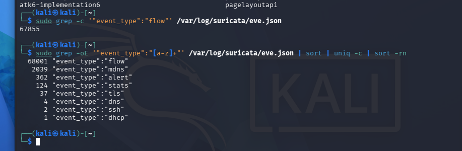
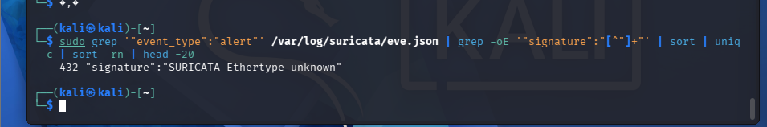

# Network IDS: testing the Suricata gap from the pentest

The [pentest report](../pentest/REPORT.md) found that a full Nmap port scan was **invisible to Wazuh** (finding
F-04): a host-based SIEM reads logs on the endpoint, so a network scan leaves almost nothing behind. The report's
recommendation was "add a network sensor like Suricata". This is me actually testing that claim, and the result is
more nuanced than "a NIDS catches scans".

## Setup

- **Suricata 8.0.8** with the Emerging Threats Open ruleset (`suricata-update`, ~69,000 rules).
- Sensor on `eth0`, HOME_NET covering the lab subnet.
- Same attack as the pentest: `nmap -sS -p- 192.168.100.76`, then a noisier `nmap -sV --script=banner`.

> **Honest caveat on placement.** In production a network sensor sits at a gateway or a span/mirror port. On a
> switched home network a VM can't see another VM's unicast traffic, so for this lab the sensor runs next to the
> traffic source. The point being tested — *does a NIDS surface what the host-SIEM missed* — still holds; the
> placement would differ in a real deployment. Feeding `eve.json` into Wazuh via an agent is the next step.

## Result

| | Wazuh (host-SIEM) | Suricata (network sensor) |
|---|---|---|
| Saw the scan? | **0 events** | **68,001 flow records** – every connection |
| Raised a threat alert? | no | no – the 432 "alerts" are all decoder noise |




```
# event types Suricata logged during the scan
  68001 "event_type":"flow"
   2039 "event_type":"mdns"
    432 "event_type":"alert"
    ...
# what those 432 alerts actually are
    432 "signature":"SURICATA Ethertype unknown"
```

`SURICATA Ethertype unknown` is background LAN chatter (spanning-tree `01:80:C2:...`, broadcasts `FF:FF:...`),
not the attack.

## What this actually shows (three levels)

1. **Visibility.** The host-SIEM saw nothing; the network sensor recorded all 68,001 flows the scan created. If you
   only have Wazuh, a port scan is a blind spot.
2. **Visibility is not detection.** Even Suricata with 69k rules did **not** raise a signature on a plain `-sS` or a
   `-sV` scan. A raw SYN sweep doesn't match a threat signature – you catch it by analysing flow volume and
   fan-out (one source touching hundreds of ports/hosts), not by waiting for a single alert.
3. **A sensor needs tuning too.** All 432 "alerts" were noise. This is the same lesson as the Wazuh side of this
   lab, where six level-15 alerts turned out to be a false positive
   ([rule 100100](../rules/local_rules.xml)): raw alert count means nothing until you tune.

## Limitations

- Plain scans aren't signatured here; loud attacks (web scanners, exploit attempts) would trigger ET rules. A fair
  next test is a Nikto run or an NSE vuln script.
- The sensor is co-located with the attacker (see caveat above); a real deployment taps the network and feeds
  `eve.json` into Wazuh.

## Next steps

- Place the sensor properly and ingest `eve.json` into Wazuh, so NIDS alerts land in the same dashboard as the
  host alerts.
- Detect the scan by **flow analysis** (threshold on connections per source) rather than signatures.
- **ICMP tunnelling** (ptunnel-ng) as a louder test: traffic that bypasses a host firewall but stands out to a
  network sensor — oversized ICMP data sections and tool fingerprints like the `deadc0de` magic value. Needs a
  two-endpoint build, so it's a separate exercise.
