# Penetration Test Report – soc-homelab

| | |
|---|---|
| **Tester** | Ivan Tatur |
| **Date** | 8 November 2026 |
| **Type** | Internal network and web application test, grey box, own home lab |
| **Targets** | Wazuh 4.14.10 server (VM) · OWASP Juice Shop (Docker) |
| **Tools** | Kali Linux 2026.3, Nmap 7.99, Hydra 9.7, Burp Suite Community 2026.8, `md5sum` |
| **Special part** | every attack was also checked from the defender side: what did the SIEM see? |

## 1. Scope and rules of engagement

| Host | Role | In scope |
|---|---|---|
| `192.168.100.76` | Wazuh server (SIEM) – target | ✅ |
| `192.168.100.70` | Windows 11 laptop with the Wazuh agent | ✅ (not attacked in this round) |
| `127.0.0.1:3000` inside the Kali VM | OWASP Juice Shop | ✅ |
| `192.168.100.77` | Kali Linux – attacker | – |
| router, phones, other home devices | – | ❌ **out of scope** |

- Scans were run against **single IP addresses**, never against the whole `192.168.100.0/24` network, so devices
  outside the scope were not touched.
- Juice Shop is an intentionally vulnerable application. It was bound to `127.0.0.1` inside the Kali VM, so nobody
  else on the network could reach it.
- No denial-of-service tests; the password list for brute force had 10 entries.

## 2. Methodology

```
reconnaissance  ->  exploitation  ->  detection check in Wazuh  ->  remediation  ->  retest
```

The last three steps are what makes this report different from a pure attack write-up: for every finding on the
Wazuh server I checked which alerts it produced, fixed it, and repeated the attack to prove the fix.

## 3. Executive summary

The SIEM server could be taken over from the local network in under a minute. It accepted SSH logins with a
password, and the password was the published default. The attacker would have had `sudo` rights on the machine
that is supposed to detect attacks, and could delete logs or switch detection off. The web dashboard also used
its default password.

Both issues were **fixed and retested on the same day**: SSH now accepts keys only, and the dashboard password
was replaced with a generated one. Wazuh detected the brute force, including the moment it succeeded
(level 12), but did **not** detect a full port scan – a network sensor is needed for that.

The web application test found a chain from a single SQL injection to the administrator's plain-text password,
plus broken access control between customers.

| Severity | Wazuh server | Juice Shop | Total |
|---|---|---|---|
| Critical | 2 (fixed) | 1 | 3 |
| High | – | 3 | 3 |
| Medium | 1 (fixed) | 1 | 2 |
| Low | – | 1 | 1 |
| Informational | 1 | – | 1 |

## 4. Findings overview

| ID | Finding | Target | Severity | Status |
|---|---|---|---|---|
| F-01 | SSH password login with the default password (brute force) | Wazuh | **Critical** | ✅ fixed, retested |
| F-02 | Default dashboard credentials `admin` / `admin` | Wazuh | **Critical** | ✅ fixed, retested |
| F-03 | Unknown SSH key left in the image (`authorized_keys`) | Wazuh | Medium | ✅ removed |
| F-04 | Port scan is invisible to the SIEM | Wazuh | Informational | open – needs NIDS |
| F-05 | SQL injection in login → administrator access | Juice Shop | **Critical** | open (by design) |
| F-06 | Password hash in the JWT, weak admin password, no 2FA | Juice Shop | High | open (by design) |
| F-07 | Passwords stored as unsalted MD5 | Juice Shop | High | open (by design) |
| F-08 | IDOR – any customer can read any basket | Juice Shop | High | open (by design) |
| F-09 | Verbose errors disclose SQL and stack trace | Juice Shop | Medium | open (by design) |
| F-10 | CORS `Access-Control-Allow-Origin: *` | Juice Shop | Low | open (by design) |

## 5. Reconnaissance

```bash
sudo nmap -sS -sV -p- 192.168.100.76 -oN scan-wazuh.txt
```

| Port | Service | Notes |
|---|---|---|
| 22 | OpenSSH 9.9 | password authentication allowed → F-01 |
| 443 | HTTPS | redirects to `/app/login`; header `osd-name: wazuh-server` reveals the product → F-02 |
| 1514 | Wazuh agent events | |
| 1515 | Wazuh agent enrollment | enrollment without a password was **not tested** – recommended next check |
| 55000 | Wazuh API | requires authentication |

The indexer port `9200` was not reachable from the network – it listens only inside the VM, which is correct.

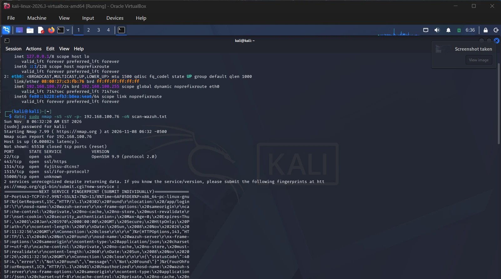

## 6. Findings – Wazuh server

### F-01 SSH password login with the default password – Critical ✅ fixed

**What:** SSH accepted passwords, and `wazuh-user` still had the default password from the documentation.
`wazuh-user` has `sudo` rights.

**Evidence:** a 10-word list with the default password in 9th place:

```bash
hydra -l wazuh-user -P pass.txt -t 4 ssh://192.168.100.76
# [22][ssh] host: 192.168.100.76   login: wazuh-user   password: wazuh
# 1 of 1 target successfully completed, 1 valid password found
```

The whole attack took **10 seconds** (12:57:46–12:57:56 CET; the Kali clock was still on EST at that time).

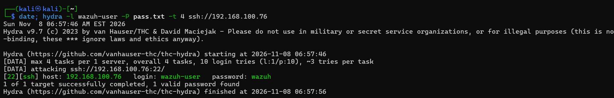

The server journal shows the moment of compromise:

```
11:57:53 UTC sshd-session: Accepted password for wazuh-user from 192.168.100.77 port 40032 ssh2
```

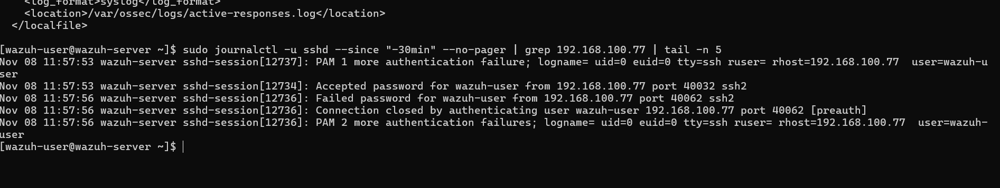

**Impact:** full control over the SIEM: delete logs, change rules, stop the service – blind the defenders.

**Detection (Wazuh):**

| Time (CET) | Rule | Level | Description |
|---|---|---|---|
| 12:57:48 | 5503 ×4 | 5 | PAM: user login failed |
| 12:57:50–56 | 5760 ×9 | 5 | sshd: authentication failed |
| 12:57:52 | **5763** | **10** | sshd: brute force trying to get access to the system |
| 12:57:54 | **40112** | **12** | **multiple authentication failures followed by a success** |
| 12:57:58 | 2502 | 10 | user missed the password more than one time |

Rule 40112 is the alert an L1 analyst must escalate immediately: it is no longer an attempt, it is a compromised
account. Hydra kept trying for a few more seconds after the success because it runs 4 parallel tasks.

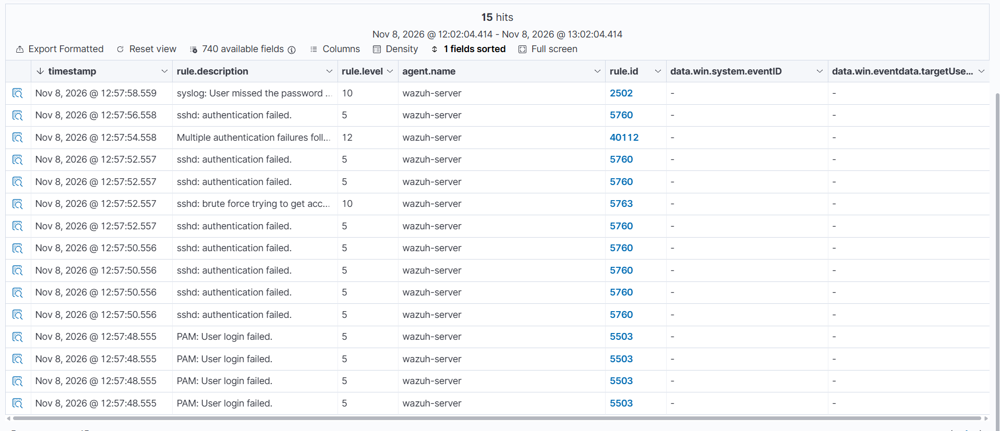

**Remediation (applied):**
1. Key-based login: an **ECDSA P-384** key. The first try with an Ed25519 key failed – the server runs in
   **FIPS mode**, and sshd logged `Ed25519 keys are not allowed in FIPS mode`. Useful to know: in regulated
   environments FIPS is common and "modern defaults" may not work.
2. Password login switched off:
   ```bash
   echo "PasswordAuthentication no" | sudo tee /etc/ssh/sshd_config.d/00-no-password.conf
   sudo sshd -t && sudo systemctl restart sshd
   # sshd -T: passwordauthentication no, kbdinteractiveauthentication no
   ```

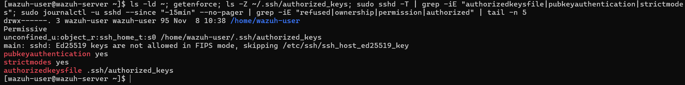

**Retest:**
```
[ERROR] target ssh://192.168.100.76:22/ does not support password authentication (method reply 100).
```

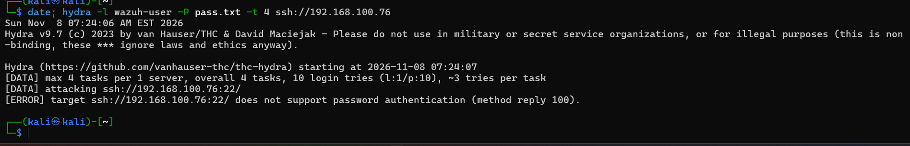

### F-02 Default dashboard credentials – Critical ✅ fixed

**What:** the dashboard on port 443 used `admin` / `admin`. The product is easy to identify (header
`osd-name: wazuh-server`, path `/app/login`), and the default credentials are in the public documentation.

**Impact:** read all security events, see what the defenders can and cannot detect.

**Remediation (applied):** a generated password set over SSH:
```bash
sudo bash /usr/share/wazuh-indexer/plugins/opensearch-security/tools/wazuh-passwords-tool.sh -u admin
sudo systemctl restart filebeat wazuh-dashboard
sudo filebeat test output        # talk to server... OK – alerts still flow into the indexer
```

**Retest:** `admin` / `admin` is rejected, the new password works, alert counters are intact.

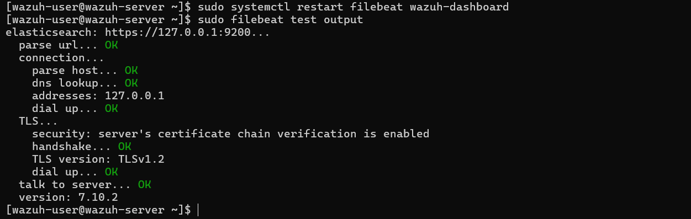

### F-03 Unknown SSH key in the image – Medium ✅ removed

**What:** `~/.ssh/authorized_keys` of `wazuh-user` contained a key that I had not added:
`ssh-ed25519 AAAAC3NzaC1lZDI1NTE5AAAAIL6LE572U2Hu... vagrant` – most likely left over from building the image.
I compared it with Vagrant's public "insecure key", whose private part is published: **it does not match**.
Its origin is unknown.

**Impact:** whoever holds the private key could log in to every VM deployed from this image. (In this case the
server's FIPS mode would also reject an Ed25519 key, but that is luck, not a control.)

**Remediation (applied):** key removed. Reviewing `authorized_keys` is a standard step when checking a Linux
server for persistence (MITRE ATT&CK T1098.004).

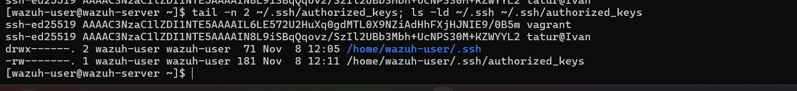

### F-04 Port scan is invisible to the SIEM – Informational

**What:** a full scan of all 65,535 ports produced **0 alerts**. The only trace was one journal line from the
version probe on SSH: `Connection closed by 192.168.100.77 port 50006`. Wazuh received it (it reads journald),
but no rule treats it as suspicious.

**Why:** Wazuh is a **host-based** system – it reads logs on the endpoints. A port scan happens on the network
and leaves almost nothing in host logs.

**Recommendation:** add a network IDS (for example Suricata) and send its alerts to Wazuh.

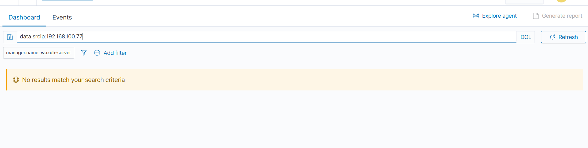

## 7. Findings – OWASP Juice Shop

Juice Shop is vulnerable on purpose, so these findings are expected. The point was to practise the method:
intercept in Burp → change in Repeater → prove the impact → write a fix.

### F-05 SQL injection in login – Critical

**Request** (`POST /rest/user/login`):
```json
{"email":"' OR 1=1--","password":"x"}
```
**Response:** `200 OK`, a JWT and `"umail":"admin@juice-sh.op"` – logged in as the administrator without a password.

**Why it works:** the input is concatenated into SQL:
```sql
SELECT * FROM Users WHERE email = '' OR 1=1--' AND password = '...'
```
`OR 1=1` makes the condition true, `--` comments out the password check, and the first user is the admin.

**Remediation:** parameterised queries (bound replacements in Sequelize); never build SQL from user input.

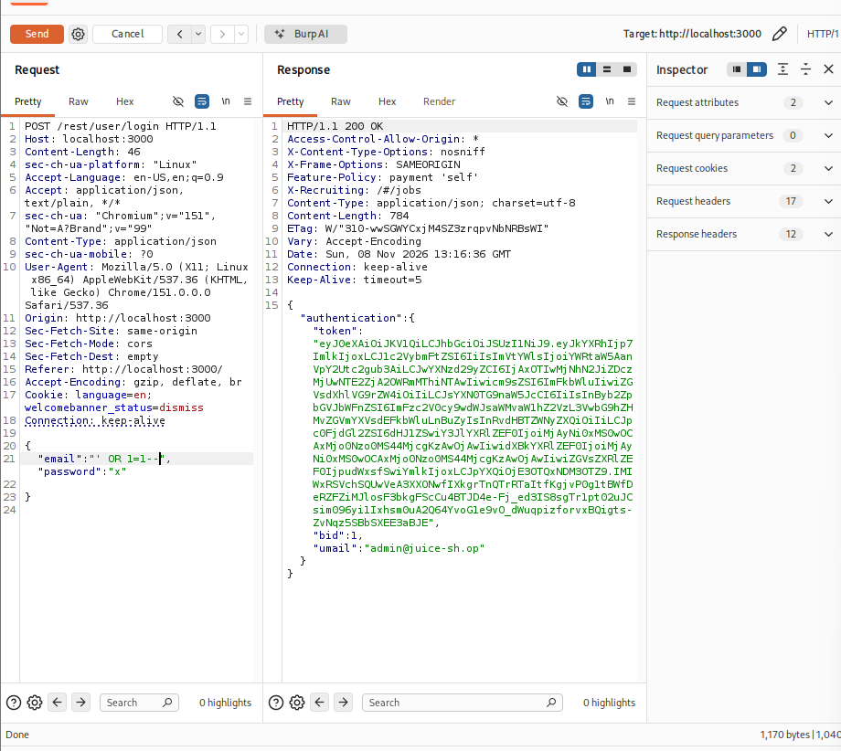

### F-06 Password hash in the JWT, weak admin password, no 2FA – High

**What:** the middle part of the JWT is only Base64, not encrypted. Decoded:
```json
{"data":{"id":1,"email":"admin@juice-sh.op","password":"0192023a7bbd73250516f069df18b500","role":"admin","totpSecret":"", ...}}
```
```bash
echo -n admin123 | md5sum
0192023a7bbd73250516f069df18b500  -
```
The administrator's password is `admin123`, and `totpSecret` is empty – no two-factor authentication.

**Attack chain:** SQL injection → admin token → password hash inside the token → unsalted MD5 → plain-text
password. The attacker keeps access **even after the SQL injection is fixed**.

**Remediation:** keep only `id` and `role` in the token; a strong admin password; mandatory 2FA for admin accounts;
after an incident, change the password and revoke issued tokens.

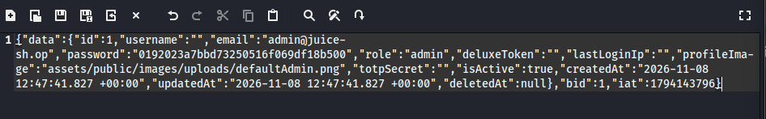
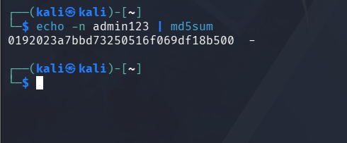

### F-07 Passwords stored as unsalted MD5 – High

**What:** the SQL error in F-09 shows the password `x` as `9dd4e461268c8034f5c8564e155c67a6`, which is MD5("x").
Unsalted MD5 is cracked in seconds with precomputed tables, so a database leak exposes most passwords at once
(OWASP A02 Cryptographic Failures).

**Remediation:** a slow, salted algorithm – bcrypt or Argon2.

### F-08 IDOR – any customer can read any basket – High

**What:** with the token of an ordinary customer (`id 25`, `role: customer`) the request
`GET /rest/basket/1` returned the basket of `UserId 1` – the administrator. The server takes the basket number
from the URL and does not check who owns it (OWASP A01 Broken Access Control).

**Impact:** iterating `/rest/basket/1, 2, 3...` reveals the baskets of all customers.

**Remediation:** check on the server that `basket.UserId` equals the user ID from the token and return `403`
otherwise; better, take the basket from the user's session instead of the URL.

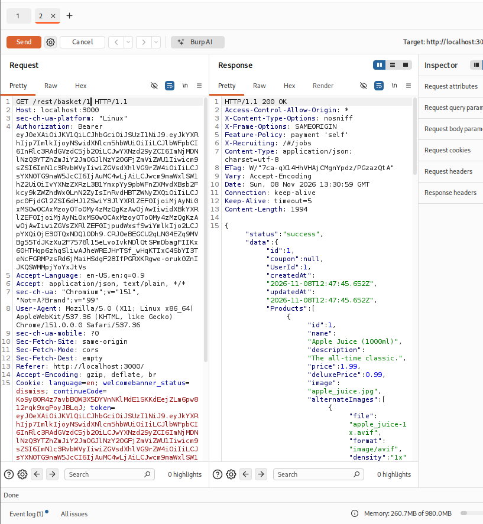

### F-09 Verbose errors disclose SQL and stack trace – Medium

**What:** the input `'` returns `500` with the full SQL statement, the database (`SQLITE_ERROR`), the ORM
(Sequelize) and file paths (`/juice-shop/node_modules/...`). An attacker gets the query structure for free.

**Remediation:** a generic error message for users; details only in server-side logs.

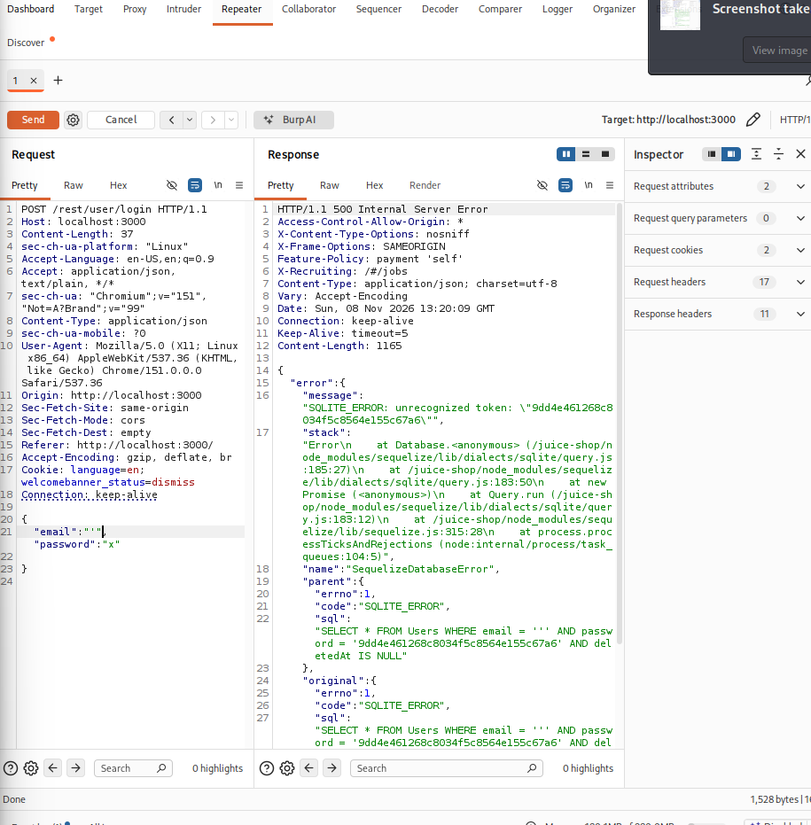

### F-10 CORS `Access-Control-Allow-Origin: *` – Low

**What:** every API response allows any origin, so any website can read API responses in the victim's browser.

**Remediation:** allow only the application's own domain.

## 8. Detection view – what the SIEM saw

| Attack | Seen by Wazuh? | Notes |
|---|---|---|
| Nmap full port scan | ❌ | one harmless journal line, no alert – needs NIDS |
| SSH brute force | ✅ | 5763 (level 10) within seconds of the first failed attempt |
| **Successful** brute force | ✅ | **40112 (level 12)** – the key alert |
| Juice Shop attacks | ❌ | the app ran inside the attacker VM without an agent; in production the sources would be the WAF, reverse proxy and application logs |

## 9. Lessons learned

- A full port scan and a successful SQL injection both went unseen – the SIEM is only as good as the logs it gets.
- Wazuh handled SSH brute force well with built-in rules, including the most important case: failures followed
  by a success.
- Fixing is not the end: every fix on the Wazuh server was retested with the same attack.
- Always check which machine you are on before changing anything – I once ran the SSH hardening commands on the
  attacker VM instead of the server and noticed it from the prompt.
- Findings are linked: the SQL injection alone is bad, but the chain to the plain-text admin password is what
  makes it critical even after a patch.

## 10. Next steps

- Test agent enrollment on port 1515 (can anyone register a fake agent?).
- Suricata as a network sensor, alerts into Wazuh. **Tested — see [network-ids/](../network-ids/README.md):**
  Suricata recorded all 68k scan flows that Wazuh missed, but a plain scan raised no signature (visibility ≠ detection).
- Change the console password of `wazuh-user` (SSH is now key-only, the console still uses the default).
